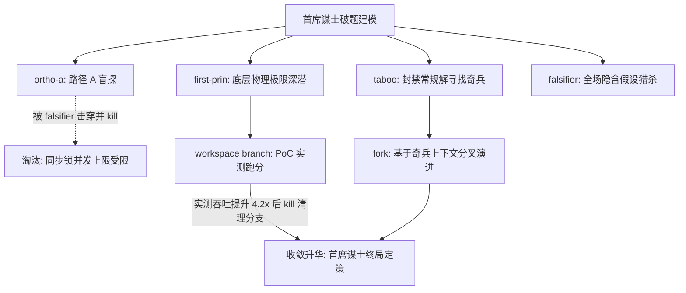

# 《首席谋士策论》交付体裁与视觉复盘规范

谋士的最终价值，在于把几万到数十万 Token 的高强度并发碰撞、分支试错与血腥证伪，压缩成一篇**主见鲜明、锐利深刻、毫无废话、拿来就能拍板或落地**的《首席谋士策论》。

长篇完整策论应作为会话级 Markdown Artifact 写入 `<Artifact Directory Path>/strategist_treatise.md`（`UserFacing: true`, `RequestFeedback: false`），并在对话正文中输出精炼的**核心裁断速览**与 Artifact 链接。

---

## 一、 策论写作铁律（防平庸指南）

1. **禁止“各打五十大板”式汇总**：不要按“分身 A 说了什么、分身 B 说了什么”流水账罗列，也不要得出“既要……又要……”的圆滑废话。你必须明确选边、定调、取舍。
2. **所有关键论断必须带证据来源**：标明是来自哪一处【源码实读（附路径/行号）】、【沙盒脚本演算】、【隔离分支 PoC 实测数据】，还是【基于已知边界的逻辑推演】；开局由谋士自行兜底的合理假设必须在第一章显式列出。
3. **保留“被证伪的失败探索”高价值遗产**：为什么淘汰掉最诱人的常规解法往往比最终方案本身更有价值——专门用一节《证伪墓志铭》把走不通的死路永久钉死，避免用户日后反复踩坑。

---

## 二、 标准六段式结构模板

```markdown
# 《首席谋士策论》：<议题凝练标题>

> **核心结论一句话**：<用最犀利的一句话直接宣布定策方向与核心破局点>

---

## 一、 首席裁断（The Strategic Verdict）

- **主推定策路线**：<清晰无歧义地阐明最终采纳的方案全貌——如果是从奇兵方案提纯升华而来，明确说明为何压倒了主流惯性解>
- **核心胜手（Winning Leverage）**：<整套方案中起到四两拨千斤作用的那 1–2 个关键结构性设计>
- **显式假设边界（Explicit Assumptions）**：
  - <假设 1：谋士在未打断用户的前提下替用户锚定的合理前提，如“默认优先保证 P99 延迟而非向后兼容旧版插件协议”>
  - <假设 2：……>
- **（可选）核心主观分叉决策树**：*仅当仍存在不可合并的极少数战略偏好选项时列出，标明“选 A 走 X / 选 B 走 Y”及各自确切代价。*

---

## 二、 破局洞见（Non-Obvious Alpha）

*提炼本次深潜挖出的、单靠单线程直答极难想到的 2–4 条深层新知：*
1. **<洞见标题：例如“问题本质不是调度慢，而是状态锁与抽象层错位”>**
   - **底层机理 / 跨界映射**：<从第一性原理或异轨视角揭示的真相>
   - **实证支撑**：<代码位置 / 演算数据 / 文献事实>

---

## 三、 证伪墓志铭（Falsified Conventional Paths）

*记录那些在首轮看似极具诱惑力、甚至业界普遍默认正确，但在本场被铁血证伪官或 PoC 实测彻底击穿的淘汰方案：*

| 被淘汰方案 | 最初诱惑点 | 致命击穿证据（逻辑反例 / 实测数据） | 淘汰归因 |
| :--- | :--- | :--- | :--- |
| `<常规方案 A>` | `<为何常规模型容易首推它>` | `<来自 falsifier 或 poc-lab 的硬核实证击穿细节>` | `底层瓶颈不可逾越 / 二阶死锁` |
| `<分支路径 B>` | `<……>` | `<……>` | `性价比低于奇兵方案 1 个数量级` |

---

## 四、 远期暗礁与事前验尸防线（Pre-Mortem & Horizon）

*站在 12–24 个月或 10 倍规模演化的未来回望当前定策，预判即使选对了方向仍可能翻车的隐患与第 1 天的防御工事：*

- **二阶反噬场景 1**：<具体因果链：当新方案上线运行后，什么外部或内部变化会反向摧毁它？>
  - **预警绊线（Tripwire）**：<可量化监测的早期恶化指标>
  - **前置逃生舱（Pre-embedded Safeguard）**：<今天在架构/策略设计中必须顺手预留的接口或熔断阀>

---

## 五、 行动路线图（Execution Blueprint）

*严格按“先验证最致命假设、再全面铺开”的先后秩序拆解（注：默认止步于策论交付；仅当用户开局要求直接落地时衔接施工）：*

1. **阶段 0（立即/低成本验证与排雷）**：<动作 + 验收标准>
2. **阶段 1（核心结构改造 / 奇兵落地）**：<动作 + 验收标准>
3. **阶段 2（远期扩展预留与绊线监控上线）**：<动作 + 验收标准>

---

## 六、 推演演化复盘（Evolution & Compute Brief）

### 1. 思维树分叉与剪枝演化图
```

### Mermaid 语法防报错铁律（必查）：
- 只使用 `flowchart TD` 或 `flowchart LR`。
- **所有包含括号 `()`、方括号 `[]`、冒号 `:`、斜杠 `/` 或中文标点的节点标签，必须整体用英文双引号包裹**，例如：`F1["fork: 零拷贝通道深潜"]`，**严禁**写裸括号或任何 HTML 标签（如 `<br/>`）。
- 推荐以虚线箭头 `-.->` 或文字标签标出被 `kill` 剪枝淘汰的废分支，以实线加粗标出主干胜出路线：



### 2. 本场算力与编排规模简报

```markdown
| 指标项 | 本场实况 |
| :--- | :--- |
| **算力底座** | 当前会话顶配单模型满血同源（零降级 / 零混编） |
| **算力烈度与轮次** | `<如：自主标准 / 极限燃烧>` · 共 `<N>` 轮交锋 |
| **首发正交算子** | `<如：ortho-a / ortho-b / taboo / first-prin / premortem / falsifier>` |
| **热分叉与实证规模** | `fork` 思维分叉 `<X>` 次 · `workspace: "branch"` 隔离 PoC `<Y>` 场（均已销毁清理） |
| **剪枝淘汰分支** | `<Z>` 路（含淘汰方案简要标识） |
| **核心交互中断次数** | `<0 / 1 / 2>` 次（仅高 VoI 分水岭） |
```
